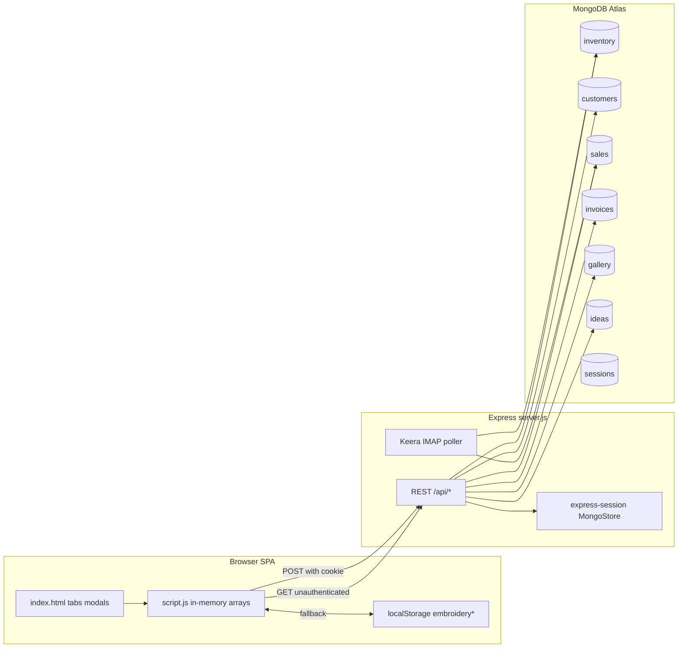

# Workflow maps and sources of truth

## Architecture (evidence-based)

## Source of truth by domain

| Domain | Authoritative store (intended) | Observed behavior | Consistency risks |
|--------|------------------------------|-------------------|-------------------|
| Project / supply identity | Mongo `inventory` documents; discriminated by `type` (`project` vs `inventory`) | Client holds `inventory[]`; save POST replaces entire collection | Full-replace races; `_id` depends on client payload |
| Customer / vendor | Mongo `customers` | Same replace pattern | Lost updates between tabs |
| Sale financials | Mongo `sales`; linked via `item.saleId`, optional `itemIndex` | Created by mark-sold, edit status, manual add, Keera email | `itemIndex` fragile; commission rules differ by path |
| Invoice history | Mongo `invoices` **merged** with `localStorage` invoices | Newer `createdAt` wins in merge | Auto-sync on load may POST merged set |
| Session | Mongo `sessions` | 24h rolling cookie | Default secret if env missing |
| Gallery / ideas | Mongo collections exist | Client **clears** arrays on load; never POSTs in `saveDataToAPI` | **Server data orphaned from UI** |
| Shop commission % | Business rule | UI: 30% if customer name matches shop (`getAutoCommissionPercentForShopCustomer`); Email: 20% for May–Jul 2026 (`getDefaultShopCommissionPercent`) | Same sale date → different commission by entry path |

## Workflow: Add project → WIP → completed → sold

1. **User** opens Projects → Add (`openAddProjectModal`) → submit → `inventory.push` with `type: 'project'`.
2. **Client** `saveData()` → if authenticated, parallel POST all collections; else localStorage + pending cloud flag.
3. **Server** `POST /api/inventory` deletes all inventory docs, re-inserts array.
4. **Mark sold** (`completeMarkAsSold`) sets `status: 'sold'`, calls `createOrUpdateSaleFromProject`, `saveData()`.
5. **Sale record** gets `listedPrice = price * quantity`, commission from customer name (not sale date), `salePrice/netAmount` = net after commission.

**Reversal:** No first-class “unsell”; user must edit status and manually adjust/delete sale row.

## Workflow: Keera email → auto sale (server)

1. **Poller** (`startKeeraSalesPoller`) or `POST /api/email-sales/poll` when IMAP configured.
2. **parse** (`lib/email-sales/parser.js`) → **match** (`matcher.js`) on shop customer inventory lines.
3. **Outcomes:** `unique_match`, `already_sold`, `ambiguous`, `skipped_gift`, `no_match`.
4. **Apply** (`applyUniqueMatches`) if not dry-run: patch inventory to sold, `insertOne` sale (does not delete other sales).

**Dry-run default:** `EMAIL_SALES_DRY_RUN` unset → `isDryRun()` true (`config.js`).

## Workflow: Invoice from completed items

1. User selects completed rows → `invoiceSummary` totals.
2. Generate invoice → builds record → `persistInvoices()` POST **full** invoice array (replace collection).
3. Requires auth; on failure keeps localStorage copy.

## Workflow: Restore / import

- **Empty DB seed:** `initializeCollections` loads `data/*.json` once (`server.js`).
- **Data tab import:** client merges JSON into memory → `saveData()`.
- **Restore from data files:** referenced in docs; **no dedicated API** in current server (use import or manual scripts).

## Failure and split-brain

| Scenario | Expected (UX copy) | Actual |
|----------|-------------------|--------|
| Not logged in, edit data | Save locally; prompt login | `saveData` → localStorage + `markCloudSavePending` |
| Partial API save (inventory OK, sales fail) | Atomic business save | `Promise.allSettled` — **partial success possible** |
| Two browsers, both save | Last writer wins | Each POST wipes collection |
| Load from API while local edits pending | — | Cache 10s + `isLoadingAPI` guard; race still possible |
